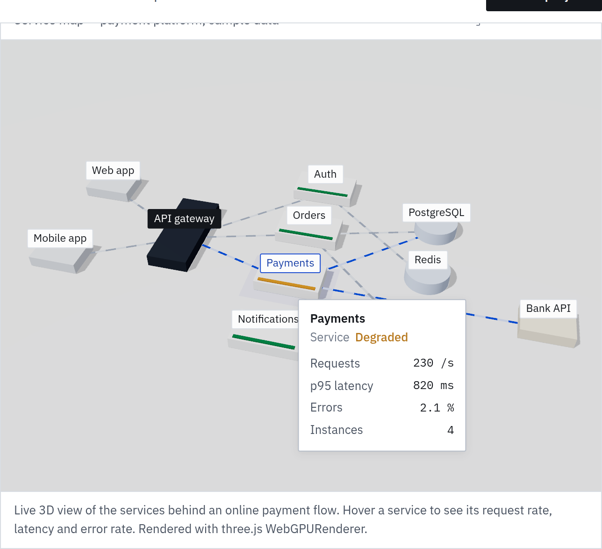
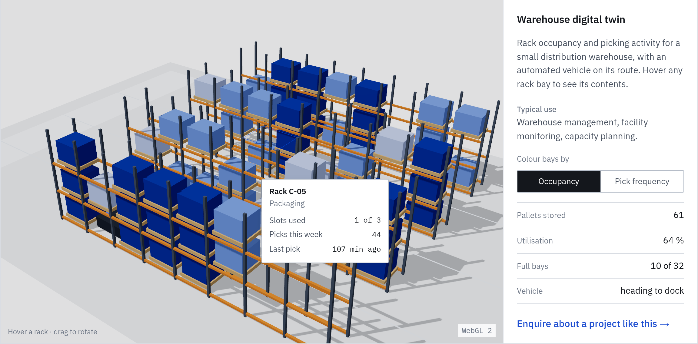

# Khalid Karimzai

Software engineer in Moscow. I build backend services in Go, Java/Kotlin and .NET, and interactive 3D interfaces for business software with three.js and WebGPU. Available for freelance and contract projects.

**Website and live examples:** https://ak-karimzai.github.io
**Enquiries:** [Telegram @AkKarimzai](https://t.me/AkKarimzai) · [ak.karimzai@gmail.com](mailto:ak.karimzai@gmail.com) · [Project enquiry form](https://github.com/ak-karimzai/ak-karimzai.github.io/issues/new?template=order.yml)

## What I build

| Service | Typical deliverables | Stack |
| --- | --- | --- |
| Backend services and APIs | REST and gRPC services with layered architecture, database schema and migrations, OpenAPI docs, Docker setup, tests | Go, Java / Kotlin (Spring), ASP.NET Core, PostgreSQL |
| 3D interfaces for the web | Digital twins, system maps, operations dashboards, product configurators with pricing logic | three.js, WebGPU / WebGL 2, TSL |
| Business web applications | Admin panels, shops and internal tools: interface, API and database as one working product | ASP.NET Core MVC, Vue, PostgreSQL |
| Automation and data collection | Scrapers, importers and scheduled jobs packaged in Docker | Python, Docker |

## Live examples

Four 3D views run live at [ak-karimzai.github.io](https://ak-karimzai.github.io), rendered with the three.js `WebGPURenderer` and TSL materials, with an automatic WebGL 2 fallback. All data shown is sample data.

Service map: components of a payment platform with request flow on the connections and request rate, latency and error rate on hover.

Warehouse digital twin: rack occupancy and pick frequency per bay, with an automated vehicle on its route. The page also has an operations dashboard (a week of API traffic as a bar surface) and a product configurator with a running price.

Source: [ak-karimzai/ak-karimzai.github.io](https://github.com/ak-karimzai/ak-karimzai.github.io)

## Selected repositories

| Repository | What it is | Patterns and stack |
| --- | --- | --- |
| [FileService](https://github.com/ak-karimzai/FileService) | File storage REST service: files on disk, metadata in a database, validated uploads, uniform error responses | Java · Clean architecture · CQRS with validators · Swagger · Docker Compose |
| [Gtracker](https://github.com/ak-karimzai/Gtracker) | Goal and task tracking API with sign-up, login and list filtering | Go · DTO validation with unit tests · Swagger docs · Docker Compose · GitLab CI |
| [PieShop](https://github.com/ak-karimzai/PieShop) / [PieShopAdmin](https://github.com/ak-karimzai/PieShopAdmin) | Online shop with a separate administration application | C# · ASP.NET Core MVC · EF migrations · Repository pattern · PostgreSQL · Docker |
| [TBank-FinTech](https://github.com/ak-karimzai/TBank-FinTech) | Assignments from the T-Bank “Fintech: Java development” course, including message-queue benchmarks | Kotlin / Java · Gradle · Docker Compose · GitHub Actions |
| [bank-api](https://github.com/ak-karimzai/bank-api) | Banking API with accounts, ledger entries and transfers (Go Backend Master Class) | Go · PostgreSQL transactions · Docker Compose |
| [domain-scraper](https://github.com/ak-karimzai/domain-scraper) | Extracts contact details from a list of domains | Python · Docker |

## How a project runs

1. **Brief.** You describe what you need; a few paragraphs are enough.
2. **Scope and quote.** I reply with questions, then a written scope with a fixed price and timeline.
3. **Build with previews.** You follow progress in a repository and on a preview link, and review each milestone.
4. **Handover.** Source code, setup documentation and help with deployment.

## Contact

Telegram [@AkKarimzai](https://t.me/AkKarimzai) · [ak.karimzai@gmail.com](mailto:ak.karimzai@gmail.com) · X [@Ak_Karimzai](https://x.com/Ak_Karimzai)
